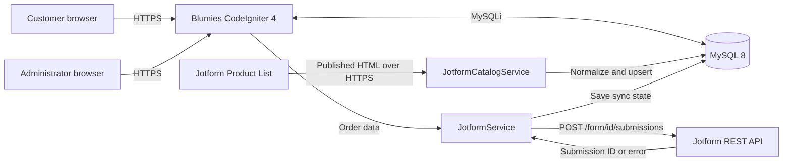

# Blumies Working Integrated System

## Panel Runbook and Technical Documentation

**Project:** Blumies e-commerce and order-management system  
**Primary application:** CodeIgniter 4 web application  
**External service:** Jotform Product List and Submissions API  
**Database:** MySQL 8  
**Document date:** November 20, 2026

---

## 1. Requirement Compliance

This repository delivers a running integrated system in which two independently useful systems exchange data through HTTPS and an external API.

| Required deliverable | Location or evidence |
|---|---|
| Working source code | [`backend/app`](../backend/app) |
| Dependency manifest | [`backend/composer.json`](../backend/composer.json) and [`backend/composer.lock`](../backend/composer.lock) |
| Runtime/container manifest | [`compose.yaml`](../compose.yaml) and [`backend/Dockerfile`](../backend/Dockerfile) |
| Safe configuration template | [`backend/.env.example`](../backend/.env.example) |
| Database migrations | [`backend/app/Database/Migrations`](../backend/app/Database/Migrations) |
| Local seed accounts | [`backend/app/Database/Seeds/UsersSeeder.php`](../backend/app/Database/Seeds/UsersSeeder.php) |
| Shared-hosting SQL setup | [`database/infinityfree_setup.sql`](../database/infinityfree_setup.sql) |
| Automated tests | [`backend/tests/unit`](../backend/tests/unit) |
| Build and run instructions | [Section 6](#6-build-and-run-with-docker-recommended) |
| Integration verification | [Section 9](#9-panel-demonstration-script) |

### Integrated systems

1. **Blumies website and MySQL service** — customer accounts, catalog display, shopping cart, checkout, orders, notifications, and administrator tools.
2. **Jotform service** — external Product List that owns catalog data and the Submissions API that receives website orders.

The integration is bidirectional at the workflow level:

- **Jotform → Blumies:** categories, names, descriptions, prices, variants, and image URLs synchronize into MySQL.
- **Blumies → Jotform:** completed website orders are converted into Jotform submissions through the REST API.

---

## 2. System Overview

Blumies is an online store for lanyards and small keepsakes. Customers can create accounts, browse a Jotform-managed catalog, add products to a cart, check out using GCash information, upload proof of payment, and track orders. Administrators can review customers and orders, change order statuses, trigger catalog synchronization, and retry failed Jotform submissions.

### Main capabilities

- Account registration, login, role-based routing, and profile management
- Jotform-backed categories and products
- Shopping cart and protected checkout
- GCash sender information, payment reference, and protected proof upload
- Local MySQL order transaction before external synchronization
- Jotform submission status, submission ID, timestamp, and retry support
- Administrator order-status management
- Database-backed customer notifications
- Responsive Bootstrap storefront and dashboard

---

## 3. Integration Architecture



### Middleware and service technologies

| Technology | Role |
|---|---|
| HTTPS | Transport between Blumies and Jotform |
| Jotform REST API | Receives completed website orders |
| CodeIgniter service classes | Transform, validate, and coordinate integration data |
| `DOMDocument` and `DOMXPath` | Extract Product List data from the published form |
| MySQL transactions | Keep local order and order-item writes consistent |
| JSON | Jotform API responses and stored product variants |
| Docker Compose | Orchestrates PHP-FPM, Nginx, and MySQL locally |

---

## 4. Data Exchange Details

### 4.1 Jotform catalog to Blumies

**Triggers:**

- Automatically when a catalog page opens and the cache is older than `JOTFORM_CATALOG_SYNC_TTL`
- Manually through **Admin → Products → Sync Catalog**
- From the command line with `php spark catalog:sync`

**Flow:**

1. `JotformCatalogService` downloads `https://form.jotform.com/{FORM_ID}`.
2. `DOMXPath` locates Product List categories and products.
3. The service normalizes identifiers, names, descriptions, prices, images, categories, and variants.
4. A database transaction updates or inserts current records.
5. Entries removed from Jotform are deleted locally, making Jotform the catalog source of truth.
6. Storefront and admin pages read the synchronized MySQL cache.

**Main source files:**

- [`JotformCatalogService.php`](../backend/app/Libraries/JotformCatalogService.php)
- [`ProductCatalog.php`](../backend/app/Libraries/ProductCatalog.php)
- [`SyncJotformCatalog.php`](../backend/app/Commands/SyncJotformCatalog.php)
- [`CatalogProductModel.php`](../backend/app/Models/CatalogProductModel.php)
- [`CatalogCategoryModel.php`](../backend/app/Models/CatalogCategoryModel.php)

| Jotform value | Local destination |
|---|---|
| Category ID and label | `catalog_categories` |
| Product ID and category | `catalog_products.jotform_product_id`, `category_id` |
| Name and description | `catalog_products.name`, `description` |
| Price | `catalog_products.price` |
| Product image | `catalog_products.image_url` |
| Product options | `catalog_products.variants` as JSON |

### 4.2 Blumies orders to Jotform

**Triggers:**

- Automatically after a local checkout transaction succeeds
- Manually through **Admin → Order → Retry Sync** if submission is pending or failed

**Reliability flow:**

1. The website validates customer, address, delivery, GCash, reference, and proof inputs.
2. The order and line items commit to MySQL first.
3. `JotformService` converts the order to Jotform values.
4. It sends an authenticated HTTPS request to the Submissions API.
5. The returned submission ID is stored on the order.
6. If Jotform is unavailable, the local order remains valid and the error is saved for retry.
7. A synchronized order is not submitted twice.

**Main source files:**

- [`Orders.php`](../backend/app/Controllers/Orders.php)
- [`JotformService.php`](../backend/app/Libraries/JotformService.php)
- [`JotformController.php`](../backend/app/Controllers/JotformController.php)
- [`Jotform.php`](../backend/app/Config/Jotform.php)
- [`OrderModel.php`](../backend/app/Models/OrderModel.php)

### Jotform mapping for form `263211686457058`

| Website value | Question ID | Notes |
|---|---:|---|
| Customer name | 3 | Composite first/last values |
| Email | 4 | Account email |
| Phone | 5 | Composite phone value |
| Street, city, region, postal code | 6, 7, 8, 9 | Delivery fields |
| Payment reference | 15 | GCash reference |
| Products, total, GCash sender, notes | 21 | Consolidated details |
| Delivery method | 28 | Selected courier/method |

Jotform's submission API does not directly populate the Product List control or upload a server-local receipt. Product lines are copied into question 21, while proof of payment remains below the public web root and is downloadable only through an admin-guarded route.

---

## 5. Dependencies and Prerequisites

### Recommended panel environment

- Git
- Docker Desktop with Docker Compose v2
- Internet access to Jotform and the frontend CDNs
- A Jotform API key for demonstrating outbound submission

| Component | Version or image |
|---|---|
| PHP | 8.3 FPM container |
| CodeIgniter | 4.6.3 |
| MySQL | 8.0 |
| Nginx | Alpine image |
| Composer | 2.x |
| PHPUnit | 10.5.x, development only |
| Bootstrap | 5.3.8 via CDN |
| Font Awesome | 7.0.1 via CDN |

The Docker image installs `intl`, `mbstring`, `pdo`, `pdo_mysql`, `mysqli`, `gd`, and `zip`. DOM/XML support is used by the catalog parser.

---

## 6. Build and Run with Docker (Recommended)

Run commands from the repository root containing `compose.yaml`.

### 6.1 Get the source

```bash
git clone https://github.com/hoshewasheetape1018/SYSINTEG-FINALS.git
cd SYSINTEG-FINALS
```

For a ZIP submission, extract it and open a terminal in `SYSINTEG-FINALS`.

### 6.2 Create configuration

Windows PowerShell:

```powershell
Copy-Item backend/.env.example backend/.env
```

macOS/Linux:

```bash
cp backend/.env.example backend/.env
```

For complete order submission, replace this value in `backend/.env`:

```dotenv
JOTFORM_API_KEY = replace_with_your_jotform_api_key
```

The public catalog works without the key. The key is required to send orders to Jotform.

### 6.3 Build and start

```bash
docker compose up -d --build
docker compose ps
```

Wait until MySQL reports `healthy`.

### 6.4 Initialize the application

```bash
docker compose exec -T php php spark migrate
docker compose exec -T php php spark db:seed UsersSeeder
docker compose exec -T php php spark catalog:sync
```

Expected catalog output resembles:

```text
Synchronized 3 categories and 12 products at YYYY-MM-DD HH:MM:SS.
```

### 6.5 Open the system

| Interface | URL |
|---|---|
| Blumies website | <http://localhost:8090> |
| Admin dashboard | <http://localhost:8090/admin/dashboard> |
| Jotform source | <https://form.jotform.com/263211686457058> |

Optional phpMyAdmin:

```bash
docker compose --profile tools up -d phpmyadmin
```

Open <http://localhost:8091> and use server `mysql`, username `root`, password `root`.

### Demonstration accounts

| Role | Username | Password |
|---|---|---|
| Administrator | `admin` | `123` |
| Customer | `testuser` | `user123` |

These credentials are for local assessment only.

### Stop or reset

```bash
docker compose down
```

To intentionally remove the local database volume:

```bash
docker compose down -v
```

The second command is destructive.

---

## 7. Non-Docker Setup

Requirements: PHP 8.1–8.4, Composer 2, MySQL 8/MariaDB, and the PHP extensions in Section 5. PHP 8.5 is not supported by the locked dependency set.

```bash
cd backend
composer install
```

Copy `.env.example` to `.env`, change the database host from `mysql` to the local host (usually `127.0.0.1`), and enter the local credentials.

```bash
php spark migrate
php spark db:seed UsersSeeder
php spark catalog:sync
php spark serve --host 0.0.0.0 --port 8090
```

Open <http://localhost:8090>. Ensure `backend/writable` is writable because logs, sessions, cache, and protected payment receipts are stored there.

---

## 8. Configuration Reference

| Variable | Required | Purpose |
|---|---|---|
| `CI_ENVIRONMENT` | Yes | `development` locally; `production` publicly |
| `app.baseURL` | Recommended | CodeIgniter base URL |
| `database.default.*` | Yes outside Compose overrides | MySQL connection |
| `JOTFORM_FORM_ID` | No | Defaults to `263211686457058` |
| `JOTFORM_API_KEY` | Yes for outbound integration | Private Jotform credential |
| `JOTFORM_API_URL` | No | Defaults to `https://api.jotform.com` |
| `JOTFORM_CATALOG_SYNC_TTL` | No | Cache lifetime; default 900 seconds |
| `JOTFORM_FIELD_MAP` | No | JSON override for changed question IDs |

### Obtain the Jotform API key

1. Sign in to the Jotform account that owns the Blumies form.
2. Open account settings and the API section.
3. Create/copy a key able to read questions and create submissions.
4. Add it only to `backend/.env` as `JOTFORM_API_KEY`.
5. Never commit or display the key.

---

## 9. Panel Demonstration Script

### A. Prove Jotform → Blumies

1. Open the Jotform Product List and note the current product count or safely edit a description.
2. Log in to Blumies as `admin`.
3. Open **Admin → Products** and select **Sync Catalog**.
4. Confirm the synchronized category/product counts.
5. Open **Shop** and confirm the Jotform name, price, image, category, and variants appear.
6. Optionally inspect `catalog_products` and `catalog_categories` in phpMyAdmin.

### B. Prove Blumies → Jotform

1. Sign in as `testuser`.
2. Select a shop product and add it to the cart.
3. Proceed to checkout.
4. Enter delivery data, GCash sender details, reference, and a small JPG/PNG/PDF proof.
5. Submit and record the website order number.
6. Sign in as `admin`; open **Admin → Orders → order details**.
7. Confirm Jotform status is `synced` and a submission ID exists. If pending/failed, use **Retry Sync**.
8. Open the Blumies form's Jotform submissions/table view and confirm the website order appears.
9. Change status in Blumies and confirm `testuser` receives the matching notification.

### Evidence to capture

- Catalog sync success message
- Same product visible in Jotform and Blumies
- Website order confirmation
- Admin order detail with submission ID
- Matching Jotform answer row
- Customer status notification

---

## 10. Database Structure

| Table | Purpose |
|---|---|
| `users` | Authentication and profiles |
| `pets` | Existing optional user-pet module |
| `catalog_categories` | Cached Jotform categories |
| `catalog_products` | Cached Jotform products |
| `orders` | Checkout, GCash, and Jotform state |
| `order_items` | Order line snapshots |
| `notifications` | User order-status notifications |
| `migrations` | Migration history |

Changes are versioned in `backend/app/Database/Migrations`. On an FTP-only host, use [`database/infinityfree_setup.sql`](../database/infinityfree_setup.sql).

---

## 11. Tests and Health Checks

```bash
docker compose exec -T php composer test
docker compose exec -T php composer health
docker compose exec -T php php spark migrate:status
docker compose exec -T php php spark catalog:sync
```

Unit tests cover catalog parsing, image fallback extraction, prices, variants, order transformation, exact Jotform question mapping, and API response handling.

---

## 12. Failure Handling

| Failure | Behavior |
|---|---|
| Published form unavailable | Cached catalog remains; error is logged/shown to admin |
| Product removed in Jotform | Next sync removes the stale local product |
| Jotform image lacks an alt label | Parser falls back to the valid image source |
| Browser image fails | Product card displays a fallback icon |
| API key absent | Local order remains with `not_configured` status |
| API timeout/rejection | Local order remains with `failed` status and retry details |
| Retry after success | Existing submission ID is returned; no duplicate is created |
| Notification table absent | Order remains valid; notification is safely skipped |

---

## 13. Troubleshooting

### `Table '...users' doesn't exist`

```bash
docker compose exec -T php php spark migrate
```

On InfinityFree, import [`database/infinityfree_setup.sql`](../database/infinityfree_setup.sql) through phpMyAdmin.

### `Jotform form ID is not configured`

Deploy the current source. The Blumies form ID is the safe default; a different form can be set with `JOTFORM_FORM_ID`.

### Catalog has zero products

```bash
docker compose exec -T php php spark catalog:sync
```

Confirm the Product List is visible on the published form.

### Order is `not_configured`

Set `JOTFORM_API_KEY` in `backend/.env`, restart PHP, then use **Retry Sync**:

```bash
docker compose restart php
```

### Port conflict

Change the host side of `8090:80` in `compose.yaml`, then restart.

### Detailed errors are public

```dotenv
CI_ENVIRONMENT = production
```

---

## 14. Security Notes

- Passwords use PHP password hashing and are never stored as plain text.
- The API key is environment-only and excluded from the repository.
- Payment proofs stay below the public root and use an admin-guarded download.
- Admin routes check the authenticated role.
- Notification actions are scoped to the owning user.
- Proof uploads are restricted by MIME type and size.
- The local database is authoritative; external failure cannot erase an order.
- Demonstration passwords must be replaced before real production use.

---

## 15. Source-Code Guide

| Concern | Location |
|---|---|
| Routes | `backend/app/Config/Routes.php` |
| Jotform configuration | `backend/app/Config/Jotform.php` |
| Catalog integration | `backend/app/Libraries/JotformCatalogService.php` |
| Order integration | `backend/app/Libraries/JotformService.php` |
| Catalog refresh facade | `backend/app/Libraries/ProductCatalog.php` |
| Checkout transaction | `backend/app/Controllers/Orders.php` |
| Retry endpoint | `backend/app/Controllers/JotformController.php` |
| Admin catalog sync | `backend/app/Controllers/AdminProducts.php` |
| Notifications | `backend/app/Libraries/NotificationService.php` |
| Models | `backend/app/Models` |
| Migrations/seeders | `backend/app/Database` |
| UI | `backend/app/Views` and `backend/public` |

---

## 16. Acceptance Checklist

- [ ] Stack builds without source edits
- [ ] MySQL is healthy
- [ ] Migrations complete
- [ ] Both seed accounts can log in
- [ ] Catalog reports synchronized products
- [ ] Storefront shows Jotform products/images
- [ ] Customer can place an order
- [ ] Jotform receives the order
- [ ] Submission ID appears in admin details
- [ ] Admin can update status
- [ ] Customer receives a notification
- [ ] Automated tests pass

Completing these checks demonstrates a working API-based integration between Blumies and Jotform with persistent MySQL storage and recoverable failure handling.
